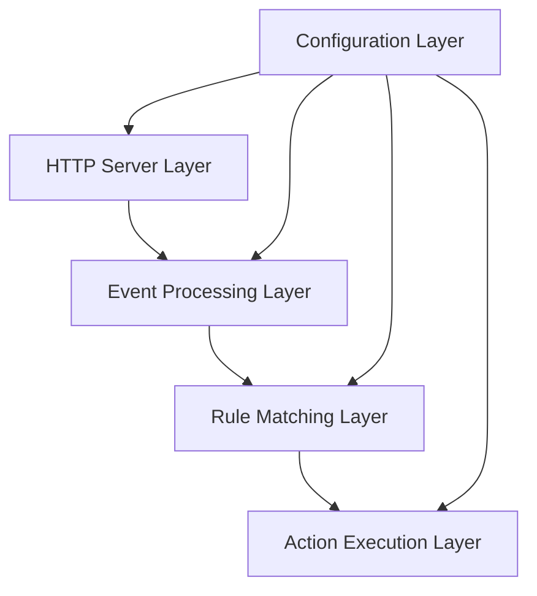
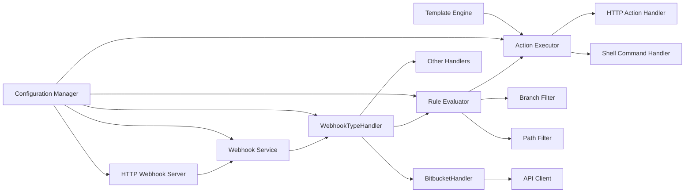
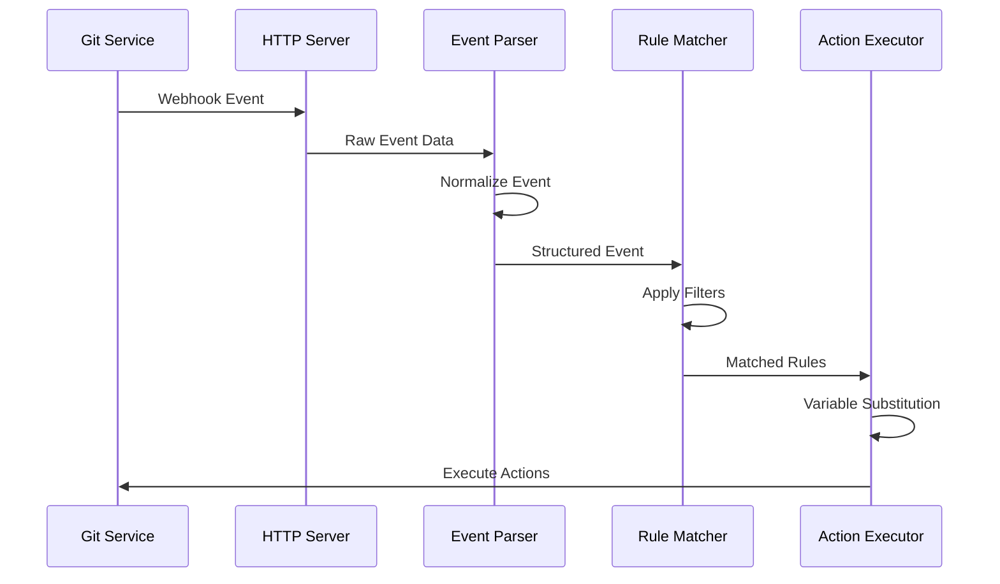
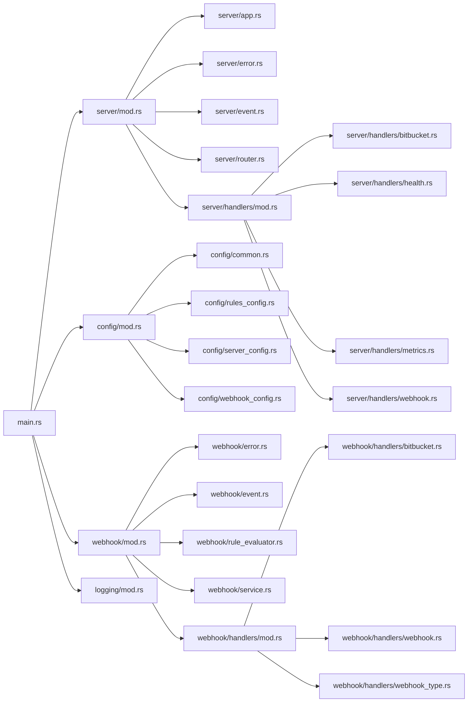

# Git-Actions: Architecture Document

## 1. System Overview and High-Level Architecture

Git-Actions is a Rust-based automation tool designed to listen for Git events and execute configurable actions based on customizable rules. The system follows a modular architecture centered around event processing, rule matching, and action execution.

### 1.1 High-Level Architecture

The system architecture is organized into several key layers:



#### Layer Responsibilities

1. **HTTP Server Layer**
   - Listens for incoming webhook events from Git hosting services
   - Handles HTTP request/response lifecycle
   - Validates webhook signatures and authentication
   - Routes requests to appropriate handlers
   - Implements health check and metrics endpoints

2. **Event Processing Layer**
   - Parses raw webhook payloads from different sources (e.g., Bitbucket, GitHub).
   - Uses type-specific handlers to normalize events into a common internal representation.
   - Extracts relevant metadata (branch, commit, files changed, etc.).
   - Makes external API calls when needed (e.g., to fetch changed files).

3. **Rule Matching Layer**
   - Evaluates events against defined rules linked via the `rule.webhooks` field.
   - Applies branch filters (`exact`, `pattern`, `regex`).
   - Applies path filters (`exact`, `pattern`, `regex`).
   - Uses a centralized rule evaluator to maintain consistent matching logic.
   - Determines which rules should trigger actions.

4. **Action Execution Layer (V1 Scope: Simple Sequential)**
   - Executes actions sequentially for matched rules. If an action fails or times out, subsequent actions for that rule are skipped.
   - Performs variable substitution in action parameters using the **Tera templating engine**.
   - Handles asynchronous execution of HTTP actions (`http:`).
   - Handles asynchronous execution of shell commands (`shell:`). **Caution:** Users must ensure safe templating practices to avoid command injection vulnerabilities.
   - Enforces a **universal, hardcoded default timeout** for all actions.
   - **Note:** Advanced action chaining (conditionals, data passing) and error handling (retries, fallbacks) are deferred beyond V1. Per-action timeouts are also deferred.

5. **Configuration Layer**
   - Loads and parses YAML configuration files (`ServerConfig`, `WebhookConfig`, `RulesConfig`) following the defined schema (apiVersion/kind/metadata/spec structure).
   - Validates configuration structure.
   - Provides access to configuration data throughout the system.
   - Relies on environment variables for secrets (`secretFromEnv`, `tokenFromEnv`, `env.*` in Tera).

### 1.2 Core Components



### 1.3 Data Flow



#### Detailed Data Flow Description (V1)

1. **Webhook Event Reception (Bitbucket)**
   - A Git service (e.g., Bitbucket, GitHub) sends a webhook event to the HTTP server.
   - The server routes the request to the appropriate webhook handler based on the URL path.
   - The handler validates the webhook signature using the secret specified by `secretFromEnv` in the matching `WebhookConfig`.
   - The raw JSON payload and HTTP headers are captured.

2. **Event Parsing and Normalization**
   - The appropriate `WebhookTypeHandler` (e.g., `BitbucketHandler`) processes the event.
   - The handler extracts relevant information (event type, repo, branch, etc.).
   - If needed, the handler makes API calls to get additional information (e.g., changed files).
   - Data is normalized into the internal `Event` structure.

3. **Rule Matching Process**
   - The `RuleEvaluator` evaluates the normalized event against defined rules.
   - For each rule, checks are performed:
     - Webhook Match: Does the rule's `webhooks` array contain the name of the source webhook?
     - Event Type Match: Does the event type match the rule's `event_types`?
     - Branch Filter Match: Does the event's branch match the rule's `branches` filters?
     - Path Filter Match: Do changed files match the rule's `paths` filters?
   - Rules passing all checks are collected.

4. **Action Execution (V1 - Simple Sequential)**
   - For each matched rule, the associated actions are executed **sequentially** and **asynchronously**.
   - Before execution, variable substitution is performed using the **Tera template engine** (`{{ event.* }}`, `{{ env.* }}`).
   - Actions are subject to a universal, hardcoded default timeout.
   - For HTTP actions (`http:`): Async request is made.
   - For Shell actions (`shell:`): Command is executed asynchronously (typically via `sh -c "..."` or similar).
   - Output/results are captured for logging.

5. **Result Handling (V1 - Simple)**
   - Action results (success/failure/timeout) are logged.
   - If any action in a sequence fails or times out, execution for that rule **stops**. Subsequent actions are skipped.
   - Metrics (`/metrics` endpoint) are updated.

## 2. Module Structure

The codebase is organized into the following module structure:



### 2.1 Module Descriptions

#### 2.1.1 Main Module (`main.rs`)
- Entry point for the application
- Initializes configuration
- Sets up the HTTP server
- Configures logging

#### 2.1.2 Server Module (`server/`)
- **`mod.rs`**: Server module entry point, exports components
- **`app.rs`**: HTTP server implementation using a web framework
- **`error.rs`**: Error types for the server module
- **`event.rs`**: Event handling for the server
- **`router.rs`**: HTTP route definitions and handlers
- **`handlers/`**: Endpoint-specific handlers
  - **`bitbucket.rs`**: Legacy Bitbucket-specific endpoint (for backward compatibility)
  - **`health.rs`**: Health check endpoint
  - **`metrics.rs`**: Metrics endpoint
  - **`webhook.rs`**: Generic webhook endpoint that delegates to the webhook module

#### 2.1.3 Configuration Module (`config/`)
- **`mod.rs`**: Configuration module entry point, exports components
- **`common.rs`**: Common configuration structures like Metadata
- **`rules_config.rs`**: Rule configuration structures
- **`server_config.rs`**: Server configuration structures
- **`webhook_config.rs`**: Webhook configuration structures

#### 2.1.4 Webhook Module (`webhook/`)
- **`mod.rs`**: Webhook module entry point, exports components
- **`error.rs`**: Error types for the webhook module
- **`event.rs`**: Normalized event structure
- **`rule_evaluator.rs`**: Centralized rule matching logic
- **`service.rs`**: Service coordinating webhook processing
- **`handlers/`**: Type-specific webhook handlers
  - **`mod.rs`**: Exports handler types
  - **`bitbucket.rs`**: Bitbucket-specific implementation
  - **`webhook.rs`**: Generic webhook handler
  - **`webhook_type.rs`**: WebhookTypeHandler trait definition

#### 2.1.5 Logging Module (`logging/`)
- **`mod.rs`**: Logging configuration and setup

### 2.2 Key Interfaces

#### WebhookTypeHandler Interface
```rust
#[async_trait]
pub trait WebhookTypeHandler: Send + Sync {
    /// Parse the webhook payload into a normalized Event
    async fn parse_payload(&self, payload: &Value, headers: &HashMap<String, String>, api_config: &ApiConfig) -> Result<Event, WebhookError>;
    
    /// Validate the webhook signature
    fn validate_webhook(&self, payload: &Value, headers: &HashMap<String, String>, secret: &str) -> Result<(), WebhookError>;
}
```

#### Event Structure
```rust
/// Normalized event representation that all webhook types will convert their payloads into
#[derive(Debug, Clone)]
pub struct Event {
    /// Type of the event (e.g., "push", "pull_request")
    pub event_type: String,
    
    /// Branch name (if applicable)
    pub branch: Option<String>,
    
    /// List of files changed in the event
    pub changed_files: Vec<String>,
    
    /// Original payload for reference
    pub payload: Value,
}
```

#### Rule Evaluator Interface
```rust
pub struct RuleEvaluator;

impl RuleEvaluator {
    pub fn new() -> Self;
    
    pub fn matches(&self, event: &Event, rule: &Rule) -> bool;
    
    pub fn execute_actions(&self, rule_id: &str, rule: &Rule, event: &Event) -> Result<(), WebhookError>;
    
    fn matches_pattern(&self, value: &str, pattern: &str) -> bool;
    
    fn matches_regex(&self, value: &str, regex_str: &str) -> bool;
}
```

#### Webhook Service Interface
```rust
pub struct WebhookEntry {
    pub webhook_name: String,
    pub webhook_config: WebhookConfig,
    pub handler: Box<dyn WebhookTypeHandler>,
}

pub struct WebhookService {
    path_to_entry: HashMap<String, WebhookEntry>,
    name_to_entry: HashMap<String, WebhookEntry>,
    rules: HashMap<String, Rule>,
    rule_evaluator: Arc<RuleEvaluator>,
}

impl WebhookService {
    pub fn new(config: &Config) -> Result<Self, WebhookError>;
    
    pub async fn process_webhook(&self, path: &str, payload: Value, headers: HashMap<String, String>) -> Result<Vec<String>, WebhookError>;
    
    fn get_webhook_by_path(&self, path: &str) -> Option<&WebhookEntry>;
    
    fn get_webhook_by_name(&self, name: &str) -> Option<&WebhookEntry>;
    
    fn get_rules_for_webhook(&self, webhook_name: &str) -> Vec<(String, &Rule)>;
}
