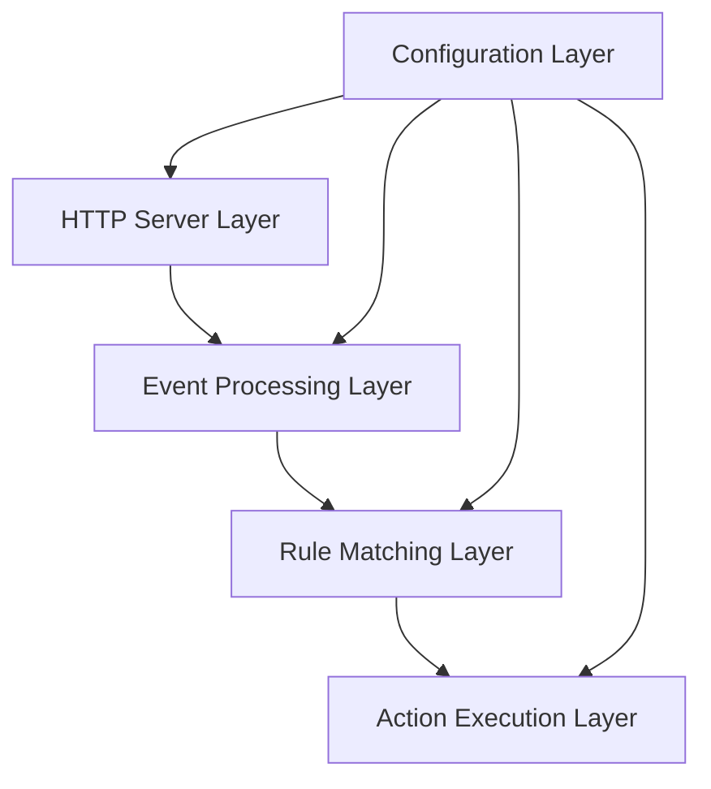
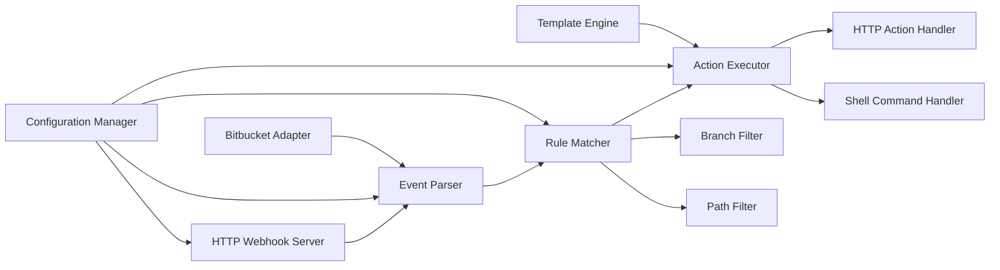
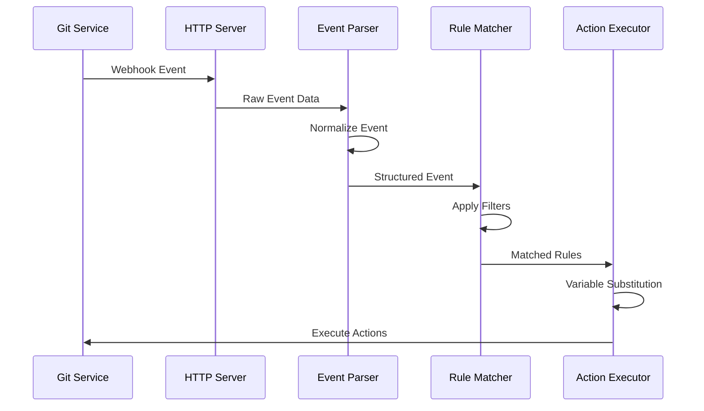
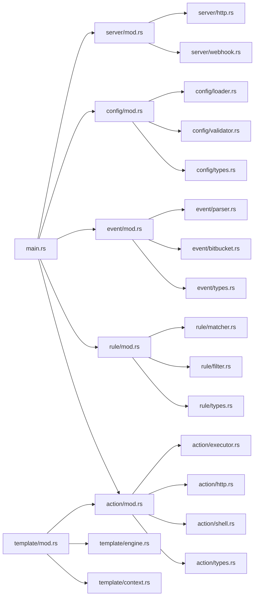

# Git-Actions: Architecture Document

## 1. System Overview and High-Level Architecture

Git-Actions is a Rust-based automation tool designed to listen for Git events and execute configurable actions based on customizable rules. The system follows a modular architecture centered around event processing, rule matching, and action execution.

### 1.1 High-Level Architecture

The system architecture is organized into several key layers:



#### Layer Responsibilities

1. **HTTP Server Layer**
   - Listens for incoming webhook events from Git hosting services
   - Handles HTTP request/response lifecycle
   - Validates webhook signatures and authentication
   - Routes requests to appropriate handlers
   - Implements health check and metrics endpoints

2. **Event Processing Layer (V1 Scope: Bitbucket Only)**
   - Parses raw webhook payloads from **Bitbucket Data Center/Server**.
   - Normalizes Bitbucket events into a common internal representation.
   - Extracts relevant metadata (branch, commit, files changed, etc.).
   - **Note:** Support for GitHub, GitLab, and Bitbucket Cloud is deferred beyond V1.

3. **Rule Matching Layer (V1 Scope: No Conditions)**
   - Evaluates events against defined rules linked via the `rule.webhooks` field.
   - Applies branch filters (`exact`, `pattern`, `regex`, `not`).
   - Applies path filters (`exact`, `pattern`, `regex`, `not`).
   - **Note:** Evaluation of the `rule.conditions` field using Tera is **deferred** in V1. Rules match based solely on webhook source, event type, branch filters, and path filters.
   - Determines which rules should trigger actions.

4. **Action Execution Layer (V1 Scope: Simple Sequential)**
   - Executes actions sequentially for matched rules. If an action fails or times out, subsequent actions for that rule are skipped.
   - Performs variable substitution in action parameters using the **Tera templating engine**.
   - Handles asynchronous execution of HTTP actions (`http:`).
   - Handles asynchronous execution of shell commands (`shell:`). **Caution:** Users must ensure safe templating practices to avoid command injection vulnerabilities.
   - Enforces a **universal, hardcoded default timeout** for all actions.
   - **Note:** Advanced action chaining (conditionals, data passing) and error handling (retries, fallbacks) are deferred beyond V1. Per-action timeouts are also deferred.

5. **Configuration Layer**
   - Loads and parses YAML configuration files (`ServerConfig`, `RulesConfig`) following the defined schema (apiVersion/kind/spec structure).
   - Validates configuration structure.
   - Provides access to configuration data throughout the system.
   - Relies on environment variables for secrets (`secretFromEnv`, `env.*` in Tera).

### 1.2 Core Components



### 1.3 Data Flow



#### Detailed Data Flow Description (V1)

1. **Webhook Event Reception (Bitbucket)**
   - Bitbucket Data Center/Server sends a webhook event to the HTTP server.
   - The server validates the webhook signature using the secret specified by `secretFromEnv` for the matching `webhook_id`.
   - The raw JSON payload and HTTP headers are captured.

2. **Event Parsing and Normalization (Bitbucket)**
   - The Bitbucket event parser extracts relevant information (event type, repo, branch, files, etc.).
   - Data is normalized into the internal `Event` structure.

3. **Rule Matching Process (V1 - No Conditions)**
   - The rule matcher evaluates the normalized event against defined rules.
   - For each rule, checks are performed:
     - Webhook Match: Does the rule's `webhooks` array contain the ID of the source webhook?
     - Event Type Match: Does the event type match the rule's `event_types`?
     - Branch Filter Match: Does the event's branch match the rule's `branches` filters?
     - Path Filter Match: Do changed files match the rule's `paths` filters?
     - **Note:** The `conditions` field is ignored in V1.
   - Rules passing all checks are collected.

4. **Action Execution (V1 - Simple Sequential)**
   - For each matched rule, the associated actions are executed **sequentially** and **asynchronously**.
   - Before execution, variable substitution is performed using the **Tera template engine** (`{{ event.* }}`, `{{ env.* }}`).
   - Actions are subject to a universal, hardcoded default timeout.
   - For HTTP actions (`http:`): Async request is made.
   - For Shell actions (`shell:`): Command is executed asynchronously (typically via `sh -c "..."` or similar).
   - Output/results are captured for logging.

5. **Result Handling (V1 - Simple)**
   - Action results (success/failure/timeout) are logged.
   - If any action in a sequence fails or times out, execution for that rule **stops**. Subsequent actions are skipped.
   - Metrics (`/metrics` endpoint) are updated.

## 2. Module Structure

The codebase is organized into the following module structure:



### 2.1 Module Descriptions

#### 2.1.1 Main Module (`main.rs`)
- Entry point for the application
- Initializes configuration
- Sets up the HTTP server
- Configures logging

#### 2.1.2 Server Module (`server/`)
- **`mod.rs`**: Server module entry point
- **`http.rs`**: HTTP server implementation using a web framework
- **`webhook.rs`**: Webhook endpoint handlers

#### 2.1.3 Configuration Module (`config/`)
- **`mod.rs`**: Configuration module entry point
- **`loader.rs`**: YAML configuration file loading
- **`validator.rs`**: Configuration validation
- **`types.rs`**: Configuration data structures

#### 2.1.4 Event Module (`event/`)
- **`mod.rs`**: Event module entry point.
- **`parser.rs`**: Defines traits for event parsing.
- **`bitbucket.rs`**: V1 implementation for Bitbucket Data Center/Server parsing.
- **`types.rs`**: Common event data structures.
- **Note:** `github.rs`, `gitlab.rs` are placeholders for future provider support.

#### 2.1.5 Rule Module (`rule/`)
- **`mod.rs`**: Rule module entry point.
- **`matcher.rs`**: Implements rule matching logic based on webhook source, event type, branch, and path filters.
- **`filter.rs`**: Contains logic for `exact`, `pattern`, `regex`, `not` filters.
- **`condition.rs`**: Placeholder for condition evaluation logic (deferred in V1).
- **`types.rs`**: Rule data structures (matching config schema).

#### 2.1.6 Action Module (`action/`)
- **`mod.rs`**: Action module entry point.
- **`executor.rs`**: Orchestrates V1 action execution: asynchronous, sequential per rule, stops on error/timeout, applies universal timeout.
- **`http.rs`**: Implements the `http:` action using an async HTTP client.
- **`shell.rs`**: Implements the `shell:` action using async process execution. Must handle timeout enforcement and capture results. Security considerations are paramount here.
- **`types.rs`**: Action data structures (matching config schema).

#### 2.1.7 Template Module (`template/`)
- **`mod.rs`**: Template module entry point.
- **`engine.rs`**: Integrates the **Tera** template engine.
- **`context.rs`**: Defines and builds the context (`event`, `env`) available during Tera rendering for action parameters.

### 2.2 Key Interfaces

#### Event Interface
```rust
// Normalized event representation
pub struct Event {
    pub event_type: EventType,
    pub source: EventSource,
    pub repository: String,
    pub branch: Option<String>,
    pub author: Option<String>,
    pub commit_hash: Option<String>,
    pub changed_files: Vec<String>,
    pub payload: serde_json::Value, // Original payload
}

// Event parser trait
pub trait EventParser {
    fn parse(&self, payload: &[u8], headers: &HashMap<String, String>) -> Result<Event, EventError>;
    fn validate_webhook(&self, payload: &[u8], headers: &HashMap<String, String>) -> Result<(), EventError>;
}
```

#### Rule Matching Interface
```rust
// Rule matcher
pub trait RuleMatcher {
    fn matches(&self, event: &Event, rule: &Rule) -> bool;
}

// Filter trait
pub trait Filter {
    fn matches(&self, value: &str) -> bool;
}
```

#### Action Execution Interface
```rust
// Action executor
pub trait ActionExecutor {
    fn execute(&self, action: &Action, context: &ActionContext) -> Result<ActionResult, ActionError>;
}

// Action context
pub struct ActionContext<'a> {
    pub event: &'a Event,
    pub rule: &'a Rule,
    pub env: &'a HashMap<String, String>,
}
