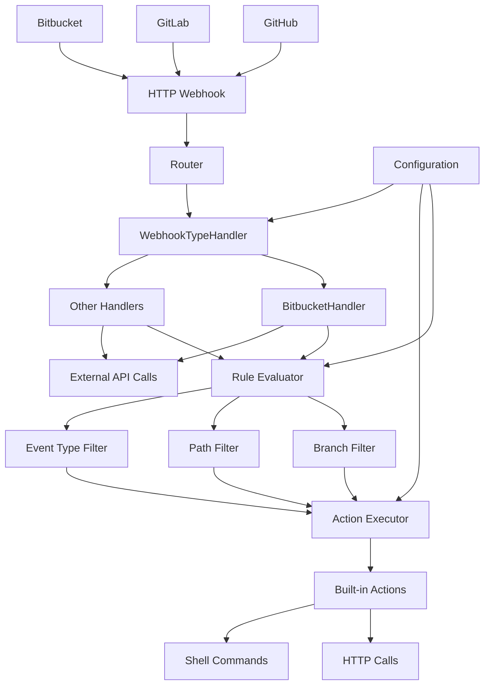

# Git-Actions: Event-Based Automation Tool Specification

## 1. Introduction

### 1.1 Purpose and Objectives

Git-Actions is a Rust-based automation tool designed to listen for Git events and execute configurable actions based on customizable rules. The primary goal is to streamline and automate CI/CD workflows by responding to specific Git events with targeted actions.

Key objectives:
- Provide a lightweight, configurable event-based automation system
- Enable fine-grained control over which events trigger which actions
- Support common Git hosting platforms out of the box
- Optimize CI/CD workflows particularly in monorepo environments
- Allow flexibility in action execution based on detailed rule matching

### 1.2 Key Capabilities

- Event listening via HTTP webhook
- Support for different webhook types (e.g., Bitbucket, GitHub) with type-specific handlers
- External API calls for additional information (e.g., changed files)
- Rule-based event filtering by branch, path, and event type
- Parameterized actions with variable substitution
- Built-in HTTP call and shell command actions
- Detailed path and file filtering
- Centralized rule matching system
- Support for action chaining and sequential workflows
- Clean separation of concerns with modular architecture

### 1.3 Target Users

- DevOps engineers managing CI/CD pipelines
- Development teams using Git-based workflows
- Organizations with monorepo architectures
- Platform engineering teams building developer infrastructure
- Anyone seeking to automate processes in response to Git events

## 2. System Architecture

### 2.1 High-Level Design

Git-Actions follows a modular architecture centered around event processing, rule matching, and action execution. The system receives events from Git hosting services, processes them against defined rules, and executes matched actions.

### 2.2 Component Diagram



### 2.3 Data Flow

1. Events are received through HTTP webhooks
2. The Router directs the request to the appropriate WebhookTypeHandler based on the URL path
3. The WebhookTypeHandler validates the webhook signature and parses the payload
4. If needed, the handler makes external API calls to get additional information (e.g., changed files)
5. The handler normalizes the event data into a common Event structure
6. The Rule Evaluator evaluates the event against all defined rules
7. For each matched rule, the Action Executor processes the associated actions
8. Actions are executed with variable substitution from the event data
9. Results and logs are recorded for monitoring

### 2.4 HTTP Webhook Interface

The tool runs an HTTP server that listens for incoming webhook events from Git hosting services. The endpoint can be configured with:
- Port number
- TLS/SSL certificates
- Authentication requirements
- Rate limiting

## 3. Event Handling

### 3.1 Webhook Type Handlers

The system uses a modular approach with type-specific handlers for different webhook sources:

#### 3.1.1 WebhookTypeHandler Interface

All webhook type handlers implement a common interface:
- Parse webhook payloads into a normalized Event structure
- Validate webhook signatures
- Make external API calls when needed
- Handle type-specific event structures

#### 3.1.2 Bitbucket Handler

- Supports Bitbucket Server/Data Center webhook payloads
- Validates webhook signatures
- Makes API calls to fetch changed files when needed
- Normalizes Bitbucket-specific event types

#### 3.1.3 Future Handlers

The modular design allows for easy addition of new webhook type handlers:
- GitHub handler
- GitLab handler
- Bitbucket Cloud handler
- Custom webhook handlers

### 3.2 Webhook Configuration

Each webhook is configured separately with:
- Unique name (used in rule references)
- URL path
- Webhook type (e.g., "bitbucket", "github")
- Secret for signature validation
- API configuration (when needed):
  - Base URL
  - Authentication details
  - Project/repository information

### 3.3 Event Types

The tool supports the following primary event types:

| Event Type           | Description |
|----------------------|-------------|
| push                 | Code pushed to a branch |
| pull_request_opened  | New pull request created |
| pull_request_updated | Pull request updated with new commits |
| pull_request_merged  | Pull request merged into target branch |
| pull_request_closed  | Pull request closed without merging |
| tag                  | New tag created |
| release              | New release created |

Additional event types can be supported based on the Git hosting service's capabilities.

### 3.4 Payload Parsing
Each WebhookTypeHandler normalizes different webhook payload formats into a standardized internal Event representation. This includes:

- Event type normalization
- Branch information extraction
- Changed files collection (from payload or via API calls)
- Original payload preservation for reference
- PR/MR status information

### 3.5 Manual Event Triggering

Events can be manually triggered by:
- Sending webhook-like payloads to the HTTP endpoint
- Using a simple CLI interface for generating test events

## 4. Rule System

### 4.1 Rule Structure

Each rule consists of:
- Name and description
- Webhook references (which webhooks this rule applies to)
- Event type filters
- Branch filters
- Path filters
- Associated actions

Example rule structure:
```yaml
apiVersion: git-actions/v1
kind: Rules
metadata:
  name: "docker-build-rules"
spec:
  rules:
    "docker-build-on-main-push":
      description: "Build Docker image when Dockerfile changes on main branch"
      webhooks: [ "github-main-repo" ]  # References WebhookConfig by name
      event_types: [ "push" ]
      branches:
        - exact: "main"
      paths:
        - pattern: "Dockerfile"
        - pattern: "docker/**/*"
      actions:
        - http:
            url: "https://ci-server/api/build"
            method: "POST"
            headers:
              Content-Type: "application/json"
            body: |
              {
                "repository": "{{ event.repository }}",
                "branch": "{{ event.branch }}"
              }
        - shell:
            command: "docker build -t myapp:{{ event.commit_hash | slice(end=7) }} ."
```

### 4.2 Event Matching

The centralized rule evaluator evaluates incoming events against all defined rules, determining which rules should trigger actions. The matching process:

1. Checks if the event's source webhook is in the rule's webhooks list
2. Checks if the event type matches any of the rule's event types
3. Verifies if the event's branch matches any of the branch filters
4. Confirms if any changed files match the path filters
5. Considers a rule matched only when all criteria are satisfied

### 4.3 Branch Filtering

Branch filters can be specified as:
- Exact matches (`exact: "main"`)
- Pattern matches using glob syntax (`pattern: "feature/*"`)
- Regular expression matches (`regex: "^release-\d+\.\d+$"`)

### 4.4 Path/File Filtering

Path filters determine which file changes should trigger the rule:
- Exact file paths (`exact: "package.json"`)
- Directory path patterns (`pattern: "src/**/*.js"`)
- Regular expressions (`regex: ".*\.sql$"`)

### 4.5 Pattern Matching Capabilities

The tool supports multiple pattern matching syntaxes:
- Glob patterns (`**/*.js`, `src/{models,controllers}/*.ts`)
- Regular expressions (`^src/.*\.rs$`)
- Simple wildcards (`*.go`, `config/**/prod.yaml`)
- Negation patterns (`!tests/**/*`)

### 4.6 Webhook-Specific Processing

Different webhook types may require different processing:
- Some webhook payloads include changed files directly
- Others require API calls to retrieve changed files
- Authentication methods vary by webhook type
- Event type normalization differs by source

## 5. Action Framework

### 5.1 Built-in Action Types

#### 5.1.1 HTTP Action

Sends HTTP requests to specified endpoints:
- Supports GET, POST, PUT, DELETE methods
- JSON payload construction with variable substitution
- Header configuration
- Authentication options (Basic, Bearer, Custom)
- Response handling and validation

Example:
```yaml
http:
  url: "https://api.example.com/webhook"
  method: "POST"
  headers:
    Content-Type: "application/json"
    Authorization: "Bearer {{ env.API_TOKEN }}"
  body: |
    {
      "repository": "{{ event.repository }}",
      "branch": "{{ event.branch }}",
      "files": {{ event.changed_files | json_encode() }}
    }
```

#### 5.1.2 Shell Command Action

Executes shell commands with parameterization:
- Command specification with variable substitution
- Working directory configuration
- Environment variable setting
- Timeout controls
- Output capturing and processing

Example:
```yaml
shell:
  command: "deploy.sh --branch={{ event.branch }} --env=production"
  working_dir: "/path/to/scripts"
  environment:
    API_KEY: "{{ env.API_KEY }}"
    DEBUG: "true"
```

### 5.2 Parameter Substitution

Actions support variable substitution using the Tera templating engine:
- `{{ event.property }}` - Access event properties
- `{{ event.payload.property }}` - Access original payload properties
- `{{ env.VAR_NAME }}` - Access environment variables

### 5.3 Variable Expansion
Tera templating provides powerful variable manipulation:
- Filters: `{{ event.commit_hash | slice(end=7) }}`
- JSON handling: `{{ event.changed_files | json_encode() }}`
- String operations: `{{ event.branch | replace(from="feature/", to="") }}`
- Conditionals: `productionstaging`
- JSONPath queries: `$jsonpath($.event, "$.payload.commits[*].id")`

### 5.4 Action Chaining

Multiple actions can be defined for a single rule:
- Sequential execution in the order defined
- Conditional execution based on previous action results
- Data passing between actions
- Early termination options

### 5.5 Error Handling

Actions include robust error handling capabilities:
- Configurable retry logic
- Failure tolerance settings
- Timeout controls
- Error notification options
- Fallback actions

## 6. Configuration Format
### 6.1 Kubernetes-Inspired YAML Schema

The tool uses a Kubernetes-inspired YAML schema with three main resource types:

#### 6.1.1 ServerConfig

```yaml
apiVersion: git-actions/v1
kind: Server
metadata:
  name: "git-actions-server"
spec:
  port: 8080
  host: "0.0.0.0"
  tls:
    enabled: false
    cert_file: "/path/to/cert.pem"
    key_file: "/path/to/key.pem"
  logging:
    level: "INFO"
    format: "json"
    file: "/var/log/git-actions.log"
  config_files:
    - "webhooks/*.yaml"
    - "rules.yaml"
```

#### 6.1.2 WebhookConfig

```yaml
apiVersion: git-actions/v1
kind: Webhook
metadata:
  name: "bitbucket-repo-a"
spec:
  path: "/webhook/bitbucket/repo-a"
  
  # Type-specific configuration
  bitbucket:
    tokenFromEnv: "BITBUCKET_MYREPO_TOKEN"
    
    # API configuration for making calls to Bitbucket API
    api:
      baseUrl: "https://bitbucket.example.com/rest/api/1.0"
      project: "PROJ"
      repo: "repo-a"
      auth:
        type: "token"
        tokenFromEnv: "BITBUCKET_API_TOKEN_A"
```

#### 6.1.3 RulesConfig

```yaml
apiVersion: git-actions/v1
kind: Rules
metadata:
  name: "default-rules"
spec:
  rules:
    "run-tests":
      description: "Run tests when a PR is created or updated"
      webhooks:
        - "bitbucket-repo-a"
        - "bitbucket-repo-b"
      event_types:
        - "pull_request_opened"
        - "pull_request_updated"
      branches:
        - exact: "main"
        - pattern: "feature/*"
      paths:
        - pattern: "src/**/*.ts"
      actions:
        - http:
            method: "POST"
            url: "http://jenkins.example.com/job/run-tests/build"
            headers:
              "Content-Type": "application/json"
            body: |
              {
                "parameter": [
                  {"name": "BRANCH", "value": "{{ event.branch }}"},
                  {"name": "COMMIT", "value": "{{ event.commit_hash }}"}
                ]
              }
```

Each configuration file can be validated with the tool's built-in validator.

### 6.2 Example Configurations

See the `docs/examples/` directory for detailed example configurations, including:
- Basic CI/CD workflows
- Monorepo-specific configurations
- Environment-specific deployment rules
- Specialized use cases

## 7. API Reference

### 7.1 Reserved HTTP Endpoints

The following HTTP endpoints are reserved and may not be used in webhook definitions.

#### 7.1.1 Metrics Endpoint

- `GET /metrics`
  - Returns detailed service metrics
  - Includes:
    - Uptime (time since service start)
    - Events processed (total count of received events)
    - Rules matched (count of successful rule matches)
    - Events with no matching rule (count of events that didn't match any rules)
    - Action errors (count of failed action executions)

#### 7.1.2 Health Check

- `GET /health`
  - Simple health check endpoint
  - Returns 200 OK if service is running properly

## 8. Deployment & Operation

### 8.1 Monitoring and Logging

- Log levels: ERROR, WARN, INFO, DEBUG, TRACE
- Log formats: Plain text, JSON, structured
- Metrics:
  - Events received per source
  - Rules matched
  - Actions executed
  - Execution times
  - Error rates
- Health checks:
  - Process health
  - Memory usage
  - Event processing backlog

---

For detailed example configurations, see the files in the `docs/examples/` directory.
